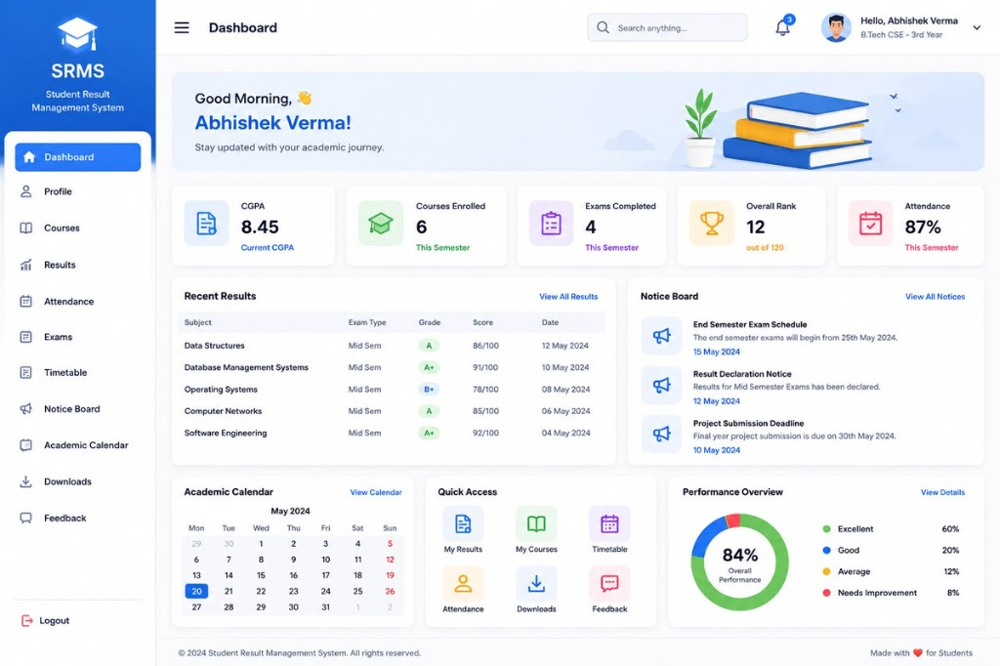

# Student Result Management System (SRMS)

A complete, production-ready full-stack Student Result Management System crafted to mirror the exact UI/UX blueprint of `Student Management systemjpg.jpg`.



---

## 🚀 Tech Stack

- **Frontend:** React 19, Tailwind CSS v4, React Router v7, Lucide Icons, Vite
- **Backend:** Node.js, Express.js (RESTful API architecture)
- **Database:** MySQL (with resilient High-Performance fallback & seed)
- **Styling:** Strict Tailwind CSS matching layout, colors, typography & component structure

---

## 📋 Features Implemented

### 1. UI/UX Blueprint Exact Replication
- **Left Sidebar:**
  - Distinct brand card with Graduation Cap icon, bold `SRMS` title and subtitle
  - Active state pills matching vibrant royal blue (`#1D61F2`)
  - Full navigation: *Dashboard, Profile, Courses, Results, Attendance, Exams, Timetable, Notice Board, Academic Calendar, Downloads, Feedback, and Logout*
- **Top Header:**
  - Left Hamburger toggle & dynamic route page title
  - Search bar input with search icon
  - Notification icon with active badge counter (`3`)
  - User profile dropdown showing avatar, student name ("Abhishek Verma"), and program ("B.Tech CSE - 3rd Year")
- **Dashboard Widgets:**
  - **Hero Banner:** Custom SVG illustration of stacked books, potted succulent plant, and flying birds with greeting *"Good Morning, 👋 Abhishek Verma!"*
  - **5 KPI Cards:**
    - `CGPA: 8.45` (Current CGPA)
    - `Courses Enrolled: 6` (This Semester)
    - `Exams Completed: 4` (This Semester)
    - `Overall Rank: 12` (out of 120)
    - `Attendance: 87%` (This Semester)
  - **Recent Results Table:**
    - Columns: Subject, Exam Type, Grade Badge (A+, A, B+), Score, Date, Actions
    - Real-time grade badges, hover row animations, and in-place CRUD modal actions
  - **Notice Board Widget:**
    - Megaphone badges, circular titles, descriptions, and publication dates
  - **Academic Calendar Widget:**
    - Month header (May 2024), Mon–Sun days (weekend highlighted in red), date matrix with `20` selected in vibrant blue
  - **Quick Access Grid:**
    - 2x3 grid: My Results, My Courses, Timetable, Attendance, Downloads, Feedback
  - **Performance Overview Donut Chart:**
    - Custom SVG donut chart displaying `84% Overall Performance`
    - Legend breakdown: *Excellent (60%), Good (20%), Average (12%), Needs Improvement (8%)*
  - **Footer:**
    - `© 2024 Student Management System. All rights reserved.`
    - `Made with ❤️ for Students`

---

## 🗄️ Database Architecture (`srms_db`)

The database schema is fully normalized and located in `backend/config/schema.sql`:

1. `students` (id, name, email, roll_no, program, current_year, semester, cgpa, overall_rank, total_students, overall_attendance, avatar_url, phone)
2. `courses` (id, course_code, course_name, credits, instructor, semester)
3. `student_courses` (id, student_id, course_id, enrollment_status)
4. `results` (id, student_id, course_id, exam_type, grade, score, max_score, exam_date)
5. `notices` (id, title, description, publish_date, category)
6. `attendance` (id, student_id, course_id, classes_held, classes_attended, percentage)
7. `calendar_events` (id, title, event_date, event_type)
8. `feedback` (id, student_id, subject, category, message, rating, status)

---

## 🛠️ Installation & Setup

### 1. Prerequisites
- Node.js (v18+)
- MySQL (Optional: XAMPP, MariaDB, or standard MySQL Server)

### 2. Backend Setup
```bash
cd backend
npm install
npm start
# Server boots on http://localhost:5000
```

### 3. Frontend Setup
```bash
cd frontend
npm install
npm run dev
# Frontend runs on http://localhost:3000
```

---

## 🧪 API Endpoints

| Method | Endpoint | Description |
|---|---|---|
| `GET` | `/api/dashboard?studentId=1` | Aggregated dashboard metrics & widgets |
| `GET` | `/api/students/:id` | Fetch student details |
| `PUT` | `/api/students/:id` | Update student profile |
| `GET` | `/api/results` | List all exam results |
| `POST` | `/api/results` | Add new result record |
| `PUT` | `/api/results/:id` | Update result record |
| `DELETE`| `/api/results/:id` | Delete result record |
| `GET` | `/api/courses` | List enrolled courses |
| `POST` | `/api/courses` | Enroll new course |
| `DELETE`| `/api/courses/:id` | Drop/delete course |
| `GET` | `/api/notices` | List campus announcements |
| `POST` | `/api/notices` | Post new announcement |
| `DELETE`| `/api/notices/:id` | Remove announcement |
| `GET` | `/api/attendance` | Fetch attendance records |
| `PUT` | `/api/attendance/:id` | Update attendance counts |

